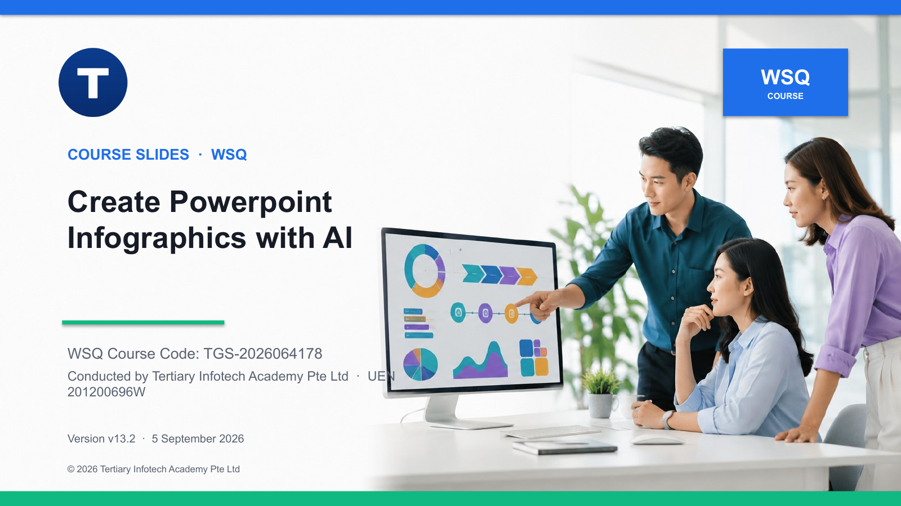

# Create Powerpoint Infographics with AI

WSQ courseware for **TGS-2026064178**, aligned to **TOU-DAT-4004-1.1-1**.

## Package

- 137-slide highly visual PowerPoint deck v13.2 and matching PDF
- Detailed Learner Guide v5.2 in DOCX, PDF and Markdown
- One-day Lesson Plan v6.2 in DOCX and PDF
- Eight progressive, self-contained activity folders with 25 matched Markdown/PDF guides
- Copy-ready Microsoft 365 Copilot prompts, editable CSV/XLSX evidence and PowerPoint start/sample files
- Twelve editable workplace infographic demonstrations: statistical, comparison, timeline, process, cycle, funnel, hierarchy, mind map, geographic, before/after, resource scorecard and decision matrix
- Secure Microsoft 365 Premium learner-access page with trainer-issued credentials kept out of learner files and public repositories

## Learning outcomes

1. Draw insights from infographics to make data-driven decisions.
2. Leverage PowerPoint infographics for articulating data insights to stakeholders.
3. Assess the effectiveness of PowerPoint infographics based on allocated resources in accordance with business goals.

## Topics

1. AI-Assisted Infographic Planning and Data Insights
2. Creating PowerPoint Infographics with AI
3. Evaluating and Presenting Infographics for Business Impact

## Copilot-to-PowerPoint workflow

Learners ground the task in approved evidence, write a structured prompt, create an infographic in the Microsoft 365 Copilot app, inspect the generated direction, and rebuild or refine decision-critical content as editable PowerPoint objects. Every activity retains source notes, checks claims, applies accessibility and brand controls, and records human approval.

The activities cover eight different design challenges: statistical KPI interpretation, comparison briefing, timeline, process, comparison data story, hierarchy, stakeholder mind map and resource scorecard.

See [courseware/CHANGELOG.md](courseware/CHANGELOG.md) for version history.

## Repository boundary

This public repository contains learner-facing courseware and activities only. Assessment papers, answer keys, reference material, QA renders, build tooling and environment configuration are deliberately excluded.

© 2026 Tertiary Infotech Academy Pte Ltd. All rights reserved.
